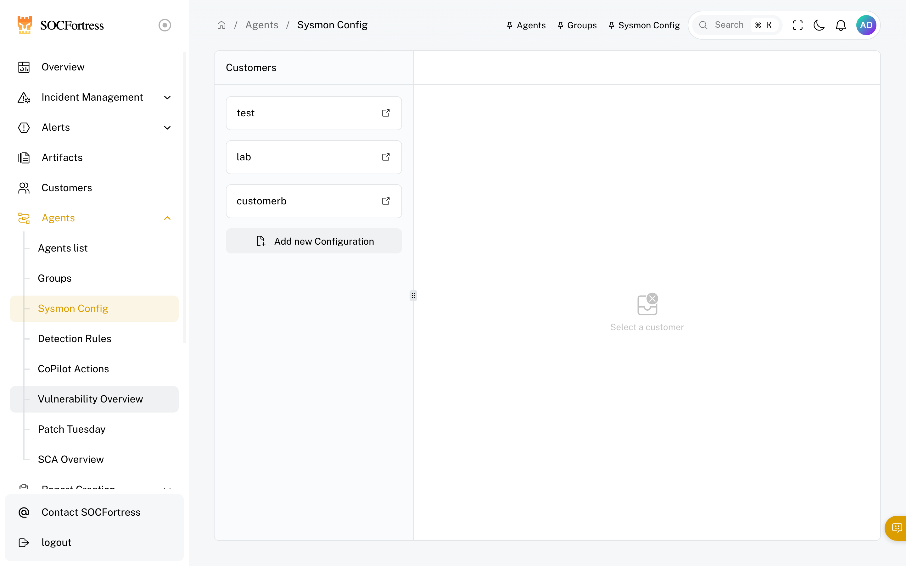
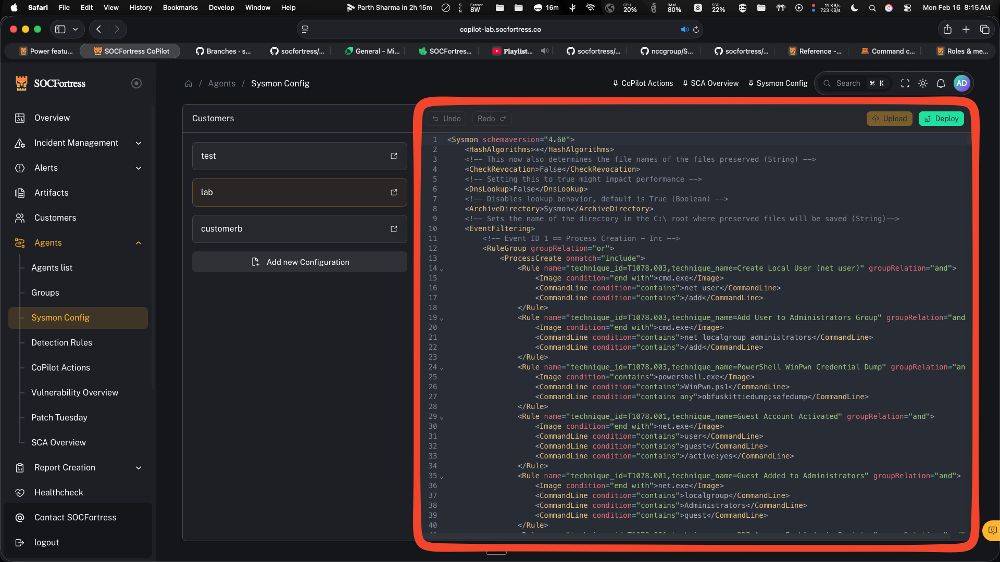

# Sysmon config (Windows)

**Menu:** Endpoints → Sysmon Config

Sysmon (System Monitor) is a Microsoft Sysinternals tool that logs high-value system activity to the **Windows Event Log**. We use it on Windows endpoints to collect richer telemetry (process, network, file, etc.) that improves detections and investigations.

In the CoPilot stack:
- **Sysmon** generates telemetry on the Windows endpoint
- The **Wazuh agent** collects Sysmon events
- The **Wazuh manager** is the source of truth and forwards that telemetry into the SIEM

---

## Why we use Sysmon

Windows Security logs are useful, but Sysmon provides additional, security-relevant telemetry that is widely adopted in SOC environments.

Benefits:
- higher-fidelity investigation data (what ran, how it ran, what it talked to)
- better detection coverage for common attacker techniques
- consistent event schemas when you standardize a baseline configuration

---

## What this page is

A centralized place to manage Sysmon configuration files so you can:
- keep Windows telemetry consistent across endpoints
- tune noise (exclude expected/benign activity)
- roll out changes per customer/group

---

## How Sysmon config management works in CoPilot (high level)

Based on the workflow in the video:

1) You maintain a Sysmon config (XML)
2) CoPilot writes the config into the appropriate Wazuh shared group directory (typically per Windows customer group)
3) Endpoints receive the updated file via Wazuh agent group sync
4) A reload mechanism applies the new Sysmon config without requiring a reboot (implementation depends on your environment)

---

## Step 1 — Review and edit the Sysmon config

Operator/engineer tips:
- Make small, intentional changes
- Track versions and keep a rollback path
- Prefer customer/group-specific configs when environments differ (EDR tools, server roles, etc.)

---

## Step 2 — Apply / reload the config

A practical pattern is to reload Sysmon after pushing a new config so changes take effect quickly.

Why this matters:
- you can respond to noise quickly (exclude noisy, expected software)
- you can add coverage quickly when a new detection need appears

---

## Starting a new customer from this CoPilot's default config

**Add new Configuration** pre-fills the editor with this CoPilot's **default Sysmon config**, when one is set, instead of an empty skeleton.

- The default is the installer's template: its install-folder paths read `C:\Program Files\__INSTALLDIRNAME__\...`. When you pick a customer, CoPilot replaces `__INSTALLDIRNAME__` with the customer's code, so the editor shows `C:\Program Files\<customer code>\...`.
- A message says the editor was pre-filled, and which install folder it used. If this customer's installer uses a different install folder (its `InstallDirName`), change those paths before uploading.
- If the default has no `__INSTALLDIRNAME__` placeholder, nothing is filled in: the editor gets the default as stored, and a warning says so. Its install-folder paths may name another customer's folder, so check them before uploading.
- The pre-filled config is **unsaved**: **Upload** stores it for the customer, and **Deploy** stays disabled until you do.
- When no default is set, or it could not be loaded, the editor starts from the empty skeleton as before, and a message says so.

The default, and **Save as default**, are for admins only.

### Save as default

**Save as default** (next to **Upload** and **Deploy**) replaces this CoPilot's default with the editor's content, after a confirmation.

- The customer's install-folder paths (exactly `\Program Files\<customer code>\`) are turned back into the `__INSTALLDIRNAME__` placeholder, so each new customer gets their own folder again. Nothing else in the config changes.
- Saving the default does **not** change the customer's stored config, and the editor keeps its unsaved changes, if any. Upload separately if this customer should get the same config.
- CoPilot checks the default like an upload (valid XML, at least one event filter, at most 5 MiB), except that it keeps `__INSTALLDIRNAME__`.
- If the saved default has no placeholder, CoPilot warns you: every new configuration will get exactly those install-folder paths.
- Each save is recorded in the audit log as `response.sysmon_default_save`, with the config's SHA-256, size and placeholder count. The XML itself is not stored there.

### Seeding the default (once per CoPilot)

1. Click **Add new Configuration** and pick any customer.
2. Replace the editor's content with `client-installer/source/Files/sysmon_config.xml` from the `main` branch of the Windows installer repository. That file still has the `__INSTALLDIRNAME__` placeholder.
3. Click **Save as default** and confirm. **Do not upload**: that customer would get the template, and the upload refuses it anyway because of the placeholder.
4. To update the default later, do the same with the new file, or edit any customer's config in the editor and save it as the default.

The default is per environment: it is stored in this CoPilot's own MinIO (in a bucket of its own, `sysmon-config-defaults`), and never leaves this CoPilot. A deploy only ever ships the customer's uploaded config, never the default, so the placeholder never reaches an endpoint.

---

## Using Sysmon to reduce SIEM noise

Sysmon configs can be very detailed. A common problem is “too much telemetry.”

Use this page to:
- exclude known-benign software that generates high event volume
- reduce ingestion costs (compute + storage)
- keep detections focused on high-signal telemetry

Example from the video context:
- if an endpoint is running an EDR tool and Sysmon is generating noisy events around specific event IDs, you can add exclusions so you don’t ingest bloat into the SIEM.

Video context:
- https://www.youtube.com/watch?v=XT1d49HTqQw

---

## Gotchas

- Sysmon configs can be complex—test changes on a small set of endpoints first.
- Any change can shift event volume dramatically—coordinate with index/retention planning.
- A broken config may fail to apply; keep validation and rollback procedures.
- **Add new Configuration** only opens a config in the editor (this CoPilot's default rendered for the customer, or an empty skeleton); nothing is stored until you upload it. Upload refuses a config without event filters, and one still carrying installer tokens such as `__INSTALLDIRNAME__` (use the rendered `sysmon_config` artifact from the customer's installer build, or the pre-filled default).
- **Deploy** ships the uploaded copy, not the editor's text, so it stays disabled while there are unsaved changes.
- Endpoints apply a deployed config through the group's `sysmon-reload` wodle. If the group already has one (also a hand-added one on an older customer), a deploy changes nothing else. A group CoPilot manages (provisioned after Phase 0) gets the wodle on an admin's deploy, through the Sysmon health apply. A group that predates that is left alone, since rewriting its agent.conf restarts its agents: CoPilot shows a warning with the health-apply command instead.
