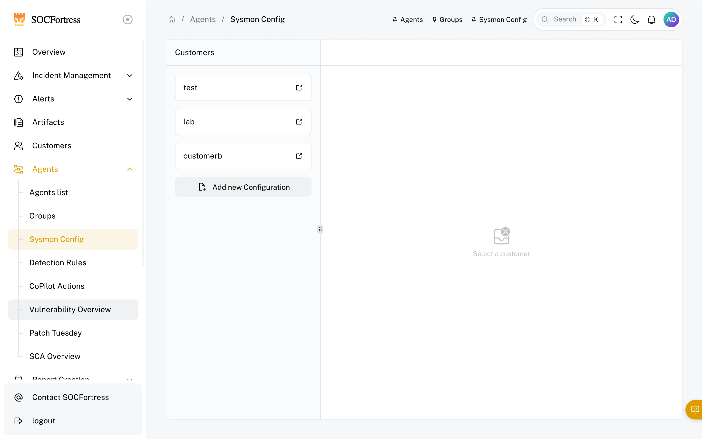
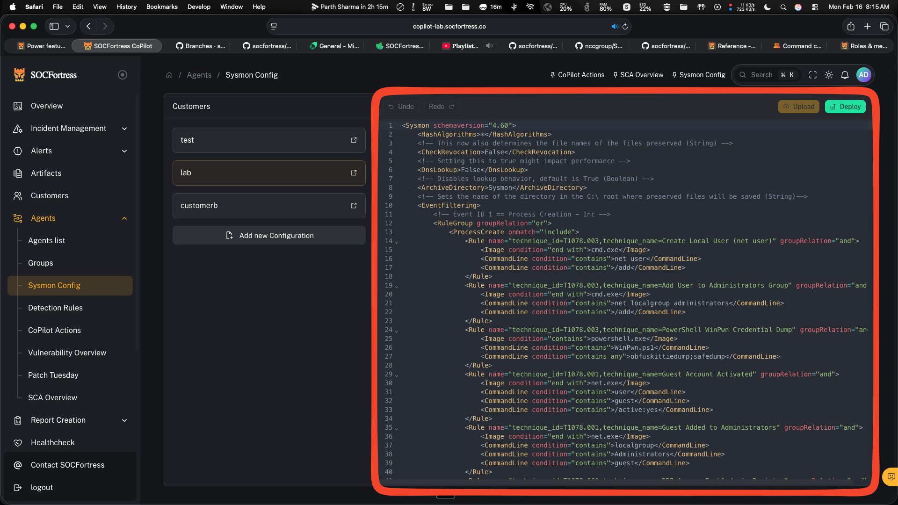

# Sysmon config (Windows)

**Menu:** Endpoints → Sysmon Config

Sysmon (System Monitor) is a Microsoft Sysinternals tool that logs high-value system activity to the **Windows Event Log**. We use it on Windows endpoints to collect richer telemetry (process, network, file, etc.) that improves detections and investigations.

In the CoPilot stack:
- **Sysmon** generates telemetry on the Windows endpoint
- The **Wazuh agent** collects Sysmon events
- The **Wazuh manager** is the source of truth and forwards that telemetry into the SIEM

---

## Why we use Sysmon

Windows Security logs are useful, but Sysmon provides additional, security-relevant telemetry that is widely adopted in SOC environments.

Benefits:
- higher-fidelity investigation data (what ran, how it ran, what it talked to)
- better detection coverage for common attacker techniques
- consistent event schemas when you standardize a baseline configuration

---

## What this page is

A centralized place to manage Sysmon configuration files so you can:
- keep Windows telemetry consistent across endpoints
- tune noise (exclude expected/benign activity)
- roll out changes per customer/group

---

## How Sysmon config management works in CoPilot (high level)

Based on the workflow in the video:

1) You maintain a Sysmon config (XML)
2) CoPilot writes the config into the appropriate Wazuh shared group directory (typically per Windows customer group)
3) Endpoints receive the updated file via Wazuh agent group sync
4) A reload mechanism applies the new Sysmon config without requiring a reboot (implementation depends on your environment)

---

## Step 1 — Review and edit the Sysmon config

Operator/engineer tips:
- Make small, intentional changes
- Track versions and keep a rollback path
- Prefer customer/group-specific configs when environments differ (EDR tools, server roles, etc.)

---

## Step 2 — Apply / reload the config

A practical pattern is to reload Sysmon after pushing a new config so changes take effect quickly.

Why this matters:
- you can respond to noise quickly (exclude noisy, expected software)
- you can add coverage quickly when a new detection need appears

---

## Starting a new customer from this CoPilot's default config

**Add new Configuration** pre-fills the editor with this CoPilot's **default Sysmon config**, when one is set, instead of an empty skeleton.

- The default is the installer's template: its install-folder paths read `C:\Program Files\__INSTALLDIRNAME__\...`. When you pick a customer, CoPilot replaces `__INSTALLDIRNAME__` with the customer's code, so the editor shows `C:\Program Files\<customer code>\...`.
- A message says the editor was pre-filled, and which install folder it used. If this customer's installer uses a different install folder (its `InstallDirName`), change those paths before uploading.
- If the default has no `__INSTALLDIRNAME__` placeholder, nothing is filled in: the editor gets the default as stored, and a warning says so. Its install-folder paths may name another customer's folder, so check them before uploading.
- The pre-filled config is **unsaved**: **Upload** stores it for the customer, and **Deploy** stays disabled until you do.
- When no default is set, or it could not be loaded, the editor starts from the empty skeleton as before, and a message says so.
- Customer codes that aren't valid folder names (letters, digits, `.`, `_`, `-`) are never written into the XML: the `__INSTALLDIRNAME__` placeholder stays in, and you replace it with the customer's install folder before uploading.

The default, **Save as default** and the SOCFortress sync status are for admins only. The default normally comes from SOCFortress (see [The default comes signed from SOCFortress](#the-default-comes-signed-from-socfortress-sync)).

### Save as default

**Save as default** (next to **Upload** and **Deploy**) replaces this CoPilot's default with the editor's content, after a confirmation.

- If the editor was pre-filled from the default (**Add new Configuration**), the customer's install-folder paths (exactly `\Program Files\<customer code>\`) are turned back into the `__INSTALLDIRNAME__` placeholder, so each new customer gets their own folder again. Any other content (a stored config, or XML you pasted) is saved exactly as it is.
- Saving the default does **not** change the customer's stored config, and the editor keeps its unsaved changes, if any. Upload separately if this customer should get the same config.
- CoPilot checks the default like an upload (valid XML, at least one event filter), except that it keeps `__INSTALLDIRNAME__`. It also refuses a default over 5 MiB, the most a Wazuh group file can be.
- If the saved default has no placeholder, CoPilot warns you: every new configuration will get exactly those install-folder paths.
- Each save is recorded in the audit log as `response.sysmon_default_save`, with the config's SHA-256, size and placeholder count. The XML itself is not stored there.
- A default saved here is kept: the SOCFortress default sync stops updating it, and the status line says so (see [the guard](#the-guard-a-default-saved-here-is-kept)).

### Seeding the default by hand (when sync is off or not configured)

With the SOCFortress default sync (below) running, you don't need this: the default arrives on its own. Seed it by hand only when sync is off or not configured:

1. Click **Add new Configuration** and pick any customer. It only lists customers without a stored config; if every customer has one, open any of them instead (saving the default never changes that customer's config).
2. Replace the editor's content with `client-installer/source/Files/sysmon_config.xml` from the `main` branch of the Windows installer repository. That file still has the `__INSTALLDIRNAME__` placeholder.
3. Click **Save as default** and confirm. **Do not upload**: that customer would get the template, and the upload refuses it anyway because of the placeholder.
4. To update the default later, do the same with the new file, or open **Add new Configuration** (pre-filled from the current default), edit it and save it as the default.

The default is per environment: it is stored in this CoPilot's own MinIO (in a bucket of its own, `sysmon-config-defaults`), and never leaves this CoPilot. A deploy only ever ships the customer's uploaded config, never the default, so the placeholder never reaches an endpoint.

### The default comes signed from SOCFortress (sync)

CoPilots run inside client networks, where SOCFortress cannot reach them. So each CoPilot **pulls** the approved default from a SOCFortress service, over the outbound HTTPS it already uses, and stores it as its default. The default is the Windows installer's template (`sysmon_config.xml` from the installer repository's `main` branch, with its `__INSTALLDIRNAME__` placeholders).

- **Every 6 hours** (the scheduled job `sync_sysmon_default`), and when an admin clicks **Sync now**. The first scheduled check runs 6 hours after the backend starts, so use **Sync now** on a new CoPilot.
- **Signed by SOCFortress.** Each release is signed (Ed25519) by the installer repository's release workflow. CoPilot checks the signature with the public keys it ships with, before it reads anything else, then checks the release's hashes, size, placeholders and the config itself (the same checks as **Save as default**). Neither the service nor anything between it and your CoPilot can plant a config. A release that fails any check changes nothing.
- **Never older.** CoPilot remembers the release it applied, and refuses an older one (or the same release number with another content), even when forced.
- **Confidential.** The config shows what is not logged, so it is never written to CoPilot's logs or audit log; only its release number, commit and SHA-256 are. CoPilot sends the service its license key (the service checks it with SOCFortress's license server), the release number it has and the release's ETag, nothing else. Logs show only a fingerprint of the license key.
- **Stored beside the default.** In the same `sysmon-config-defaults` bucket: `sync.json` (the release applied: number, commit, SHA-256s, signing key, when) and `sync-status.json` (the last check's outcome and message).

#### The status line and Sync now

Below **Add new Configuration**, admins see one line:

- `Default: SOCFortress release #<number> (<commit>), synced <time>`: the default is that release.
- `Local default differs from SOCFortress release #<number>: not updated`: an admin changed the default on this CoPilot (see the guard below).
- `SOCFortress default sync off` or `SOCFortress default sync not configured`: nothing is fetched (Sync now is disabled).
- `Default not synced from SOCFortress yet`, with the reason (no license, the service unreachable, nothing published yet, a release refused, ...).

When the last check failed, its message is shown under the line. **Sync now** checks at once. When the default was changed here, it asks first whether to replace it with SOCFortress's latest release.

#### The guard: a default saved here is kept

**Save as default** still works. Afterwards, sync **does not overwrite** that default, and the status line says so: a default that is neither the release applied last nor the one offered was changed on this CoPilot, and is left alone. Line endings don't count (the editor saves LF).

- To go back to SOCFortress's default, click **Sync now** and confirm the replacement.
- A default that equals the offered release (one you seeded by hand, for example) is adopted: CoPilot only records it as synced.
- If no default is stored, the release is stored.

#### Settings (`.env`)

| Variable | Default | |
|---|---|---|
| `SYSMON_DEFAULT_SYNC` | `on` | `on`: apply a new release unless the default was changed here. `force`: always apply it, overwriting a default saved here at every check. `off`: never fetch (air-gapped CoPilots); the default is then only what admins save. |
| `SOCFORTRESS_SYSMON_SYNC_URL` | `https://sysmon-sync.socfortress.co` | The SOCFortress sync service (the production host is still to be decided). `https` only (plain `http` only to `localhost`). |

To change them, edit `.env` and recreate the backend container (`docker compose up -d copilot-backend`). The backend reaches the service like any outbound HTTPS call, through `HTTPS_PROXY` when that is set.

Until a CoPilot version ships a SOCFortress release key, sync is **not configured**: no request is made, and the default stays whatever admins save.

#### What a check can end with

| Outcome | Meaning |
|---|---|
| `applied` | The release was stored as the default. |
| `adopted` | The stored default already was the release; only `sync.json` was written. |
| `up_to_date` | No newer release. |
| `local_default_differs` | The default was changed here; not overwritten (the guard). |
| `off`, `not_configured` | Nothing was fetched. |
| `no_license`, `invalid_url` | Nothing was fetched: no license, or an unusable `SOCFORTRESS_SYSMON_SYNC_URL`. |
| `unauthorized`, `license_rejected`, `not_published`, `rate_limited`, `service_unavailable` | The service answered 401, 403, 404, 429 or 503. |
| `network_error`, `http_error`, `redirect_refused`, `too_large` | No usable answer (a redirect to another host is never followed; answers over 12 MiB are refused). |
| `verification_failed`, `invalid_config`, `rollback_refused` | The release was refused: signature, key, format or hashes; the config itself; or older than the one applied. |
| `store_error` | This CoPilot's data store (MinIO) could not be read or written. |

Each applied or adopted release is recorded in the audit log as `response.sysmon_default_sync`, with the release number, commit, SHA-256, size and whether it replaced a default saved here (`forced`). The scheduled job's rows have the actor `system`; **Sync now** records the admin.

---

## Using Sysmon to reduce SIEM noise

Sysmon configs can be very detailed. A common problem is “too much telemetry.”

Use this page to:
- exclude known-benign software that generates high event volume
- reduce ingestion costs (compute + storage)
- keep detections focused on high-signal telemetry

Example from the video context:
- if an endpoint is running an EDR tool and Sysmon is generating noisy events around specific event IDs, you can add exclusions so you don’t ingest bloat into the SIEM.

Video context:
- https://www.youtube.com/watch?v=XT1d49HTqQw

---

## Gotchas

- Sysmon configs can be complex—test changes on a small set of endpoints first.
- Any change can shift event volume dramatically—coordinate with index/retention planning.
- A broken config may fail to apply; keep validation and rollback procedures.
- **Add new Configuration** only opens a config in the editor (this CoPilot's default rendered for the customer, or an empty skeleton); nothing is stored until you upload it. Upload refuses a config without event filters, and one still carrying installer tokens such as `__INSTALLDIRNAME__` (use the rendered `sysmon_config` artifact from the customer's installer build, or the pre-filled default).
- **Deploy** ships the uploaded copy, not the editor's text, so it stays disabled while there are unsaved changes.
- Endpoints apply a deployed config through the group's `sysmon-reload` wodle. If the group already has one (also a hand-added one on an older customer), a deploy changes nothing else. A group CoPilot manages (provisioned after Phase 0) gets the wodle on an admin's deploy, through the Sysmon health apply. A group that predates that is left alone, since rewriting its agent.conf restarts its agents: CoPilot shows a warning with the health-apply command instead.
