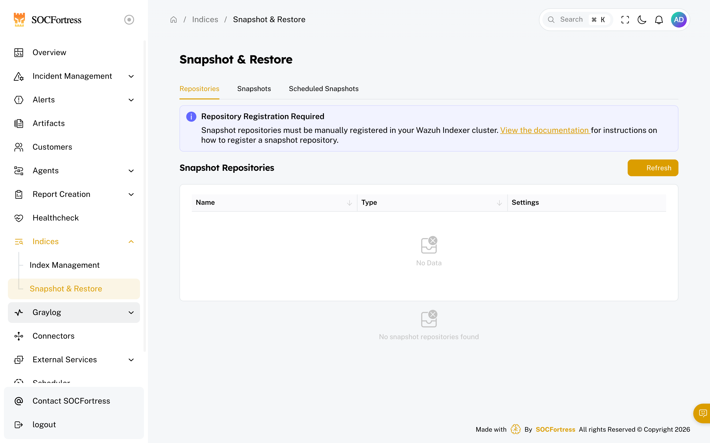
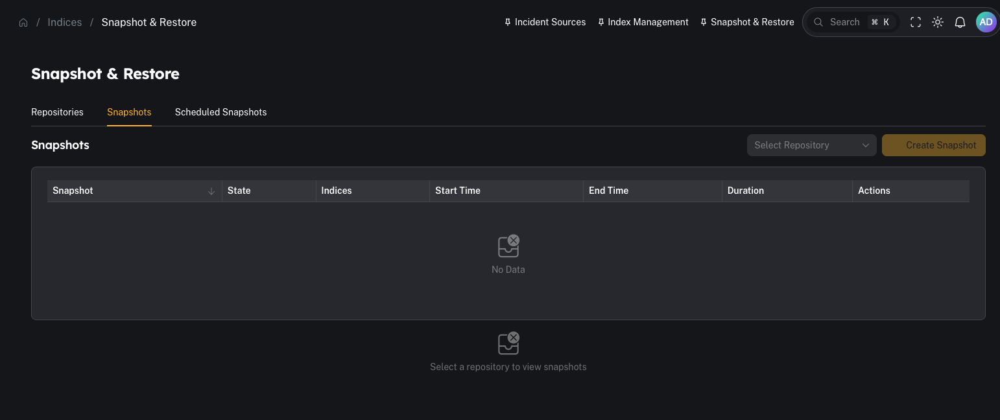
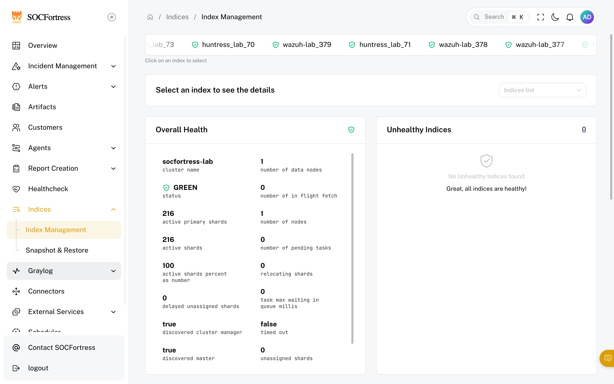

# Snapshot & restore (cold storage)

**Menu:** Platform → Log Management → Snapshot & Restore

**Best for:** Admin / Engineer

Snapshots let you **offload older indexes into cold storage** (snapshot repositories) so you can make room for new events while still keeping the ability to restore history later.



---

## When to use snapshots

Use snapshots when you need to:
- reduce disk usage on the indexer
- keep long-term historical logs without keeping them “hot”
- preserve data before major maintenance/changes

---

## Repository registration is required

CoPilot can manage snapshots, but the snapshot **repository must exist and be registered** in the Wazuh Indexer cluster first.

In the UI you’ll see this warning if none exist:

> “Snapshot repositories must be manually registered in your Wazuh Indexer cluster …”


---

## Step 1 — Verify repositories

1) Open **Platform → Log Management → Snapshot & Restore**
2) Click **Repositories**
3) Confirm at least one repository exists and is healthy

---

## Step 2 — Create a snapshot



1) Go to **Snapshots**
2) Choose the repository
3) Select the index/index pattern(s) to snapshot
4) Run the snapshot

---

## Step 3 — Restore a snapshot (when you need old data)


Restoring brings historical data back so you can:
- investigate an incident with older timelines
- run retro-hunts
- rebuild context for cases

---

## Step 4 — Schedule snapshots (automation)



If you regularly offload older logs, scheduled snapshots help keep disk usage stable.

### Index pattern

A schedule's **Index Pattern** chooses the indices it snapshots. It is a comma-separated list of parts:

| Part | Meaning |
|---|---|
| `fortinet-*` | Include every index whose name starts with `fortinet-`. `*` matches any run of characters. |
| `gl-events_2` | Include that one index. |
| `-wazuh-monitoring-*` | Exclude every index this part matches. |

- Spaces around a part are ignored: `fortinet-*, palo_alto-*` is the same as `fortinet-*,palo_alto-*`.
- An index is snapshotted when it matches at least one part to include and no part to exclude. An exclusion applies wherever it stands in the list.
- `*` is the only wildcard. A `.` matches only a dot.
- A pattern needs at least one part to include: one made only of exclusions can't be saved. It holds at most 255 characters.

The form checks the pattern against the cluster as you type, and again when you open an existing schedule. It says how many indices match right now, and **Show** lists them in name order (the first 200). A pattern that matches nothing is flagged before you save it, and so is one that can't be saved. Saving confirms the count too: "Schedule created: its index pattern matches 201 indices". The count is what matches at that moment: every run reads the pattern again, so an index created later is picked up by the next run.

Example: every tenant's Fortinet, Palo Alto, Office 365 and Wazuh index sets, without Wazuh's own monitoring, statistics and state indices, and without proof-of-concept tenants (`<name>-poc_<n>`):

```
fortinet-*,palo_alto-*,office365-*,wazuh-*,-wazuh-monitoring-*,-wazuh-statistics-*,-wazuh-states-*,-*-poc_*
```

### Last run status

| Status | Meaning |
|---|---|
| `SUCCESS` | A snapshot of the new indices was started. |
| `SKIPPED` | The pattern matched indices, but none was new: each is still being written to (with **Skip Write Indices** on) or is already in one of this schedule's snapshots. This is normal for an incremental schedule. |
| `DEFERRED` | The poll fell outside the schedule window, or the interval hasn't passed since the last run. |
| `NO_MATCH` | The pattern matched no index at all, so nothing was snapshotted. The schedule tries again at the next poll (the interval doesn't apply), and the status stays until a run matches something. Open the schedule to see what its pattern matches now. |
| `FAILED` | The run failed (the indexer, the repository or the snapshot itself). The status stays until the next run. |

A run's status ends with what retention did, when it did something: `SUCCESS: retention deleted 3 snapshots older than 365 days`.

### Retention

**Retention (Days)** deletes the schedule's own snapshots once they are older than that many days. It is checked on every run that matches indices, before the run starts its new snapshot. It never runs on a deferred poll, or on a `NO_MATCH` or failed run.

- **Only snapshots this schedule created are deleted.** The name must be the schedule's (`<prefix>_<schedule name>_<timestamp>`), and the snapshot's metadata must carry the schedule's id. Snapshots made by hand, by another schedule, or by another CoPilot writing to the same repository are never touched.
- **A snapshot still in progress is never deleted**: deleting it would abort it.
- **Age is counted from the snapshot's start.** The oldest go first, at most 50 a run (and within 5 minutes), so a backlog is worked off over several runs.
- **Clear the field to keep snapshots forever.** Lowering it deletes the older snapshots at the next run.
- **Renaming a schedule, or pointing it at another repository, leaves its earlier snapshots alone.** Delete them by hand if you no longer need them.
- **An incremental schedule snapshots each index once**, so retention removes that index from cold storage. If the index is still on the cluster when its snapshot is deleted, the next run snapshots it again.

Earlier versions stored Retention without acting on it. After upgrading, a schedule that has it set starts deleting its older snapshots at its next run, 50 a run.

### Run now

**Run now** on a schedule's card runs it once, straight away, without waiting for its window or its interval. Use it after creating a schedule or changing its pattern, to see it work. It asks first, and says what the run will do.

- **It does what a scheduled run does**: it snapshots the indices the pattern matches that none of the schedule's snapshots holds yet, under the schedule's name, and applies its Retention.
- **It counts as the schedule's run.** The card's Last run, status and Last snapshot show it, and Interval (Days) counts from it, as from any run. A daily schedule next runs on a later day: run it now at 10:00 and its 23:00 window that day is skipped.
- **It runs a disabled schedule too**, once. The schedule stays disabled.
- **One run of a schedule at a time.** While one is under way (a scheduled run, or someone else's Run now), Run now says so and does nothing.
- A message says what the run did: the snapshot it started and how many indices it holds, nothing new to snapshot, a pattern that matches no index, or why it failed.

### Schedule window (time-of-day + day interval)

By default a snapshot schedule is evaluated every 15 minutes — and if there are new indices to snapshot, it fires immediately. That can mean snapshot operations hit the Wazuh Indexer during business hours, when the cluster is busiest.

Each schedule has four optional fields that pin execution to a maintenance window:

| Field | Type | Purpose |
|---|---|---|
| **Day of Week** | `Monday … Sunday` (or empty) | Restrict execution to a single weekday. Empty = any day. |
| **Scheduled Hour** | `0–23` (or empty) | Hour of day the schedule is allowed to run. Empty = any hour (legacy behavior — runs every poll). |
| **Scheduled Minute** | `0–59` (or empty) | Minute of hour. Pairs with Scheduled Hour to form a **15-minute window** starting at this minute. Empty = any minute in the chosen hour. Disabled until Scheduled Hour is set. |
| **Interval (Days)** | `≥ 1`, default `1` | Minimum days between executions. `1` = at most once per day. `14` paired with **Day of Week** = "every other Sunday". |
| **Timezone** | IANA name, default `UTC` | Used to evaluate Day of Week / Scheduled Hour / Scheduled Minute. Examples: `UTC`, `America/Chicago`, `Europe/London`. DST is handled automatically. |

When the current time is outside the window, the schedule's **Last Execution** column shows a `DEFERRED` tag and **no Wazuh Indexer API calls are made** — there's effectively zero cluster load on deferred polls. A `NO_MATCH` or `FAILED` status isn't replaced by `DEFERRED`: it stays until the next run. The next poll inside the window picks up where it left off, and the existing "no new indices = SKIPPED" deduplication still applies.

#### Example — daily at 02:00 UTC

| Field | Value |
|---|---|
| Scheduled Hour | `2` |
| Scheduled Minute | `0` |
| Interval (Days) | `1` |
| Timezone | `UTC` |

Result: between 02:00 and 02:14 UTC each day, the schedule fires (assuming new indices exist). All other polls are deferred.

#### Example — weekly on Sunday at 01:00 US Central

| Field | Value |
|---|---|
| Day of Week | `Sunday` |
| Scheduled Hour | `1` |
| Scheduled Minute | `0` |
| Interval (Days) | `1` |
| Timezone | `America/Chicago` |

> `America/Chicago` correctly handles US Central time year-round — CST in winter (UTC-6) and CDT in summer (UTC-5).

Result: only fires on Sundays between 01:00 and 01:14 Central. All other days/times defer.

#### Example — every other Sunday at 01:00 US Central

| Field | Value |
|---|---|
| Day of Week | `Sunday` |
| Scheduled Hour | `1` |
| Scheduled Minute | `0` |
| Interval (Days) | `14` |
| Timezone | `America/Chicago` |

The `Interval (Days) = 14` blocks runs for 13 days after the last successful execution, so the next eligible Sunday after a fired run lands exactly two weeks later.

#### Backward compatibility

Schedules created before this feature was introduced — and any new schedule where Scheduled Hour is left empty — keep their original behavior: they run on every 15-minute poll and rely solely on the "new indices needed" check.

---

## Common gotchas

### “No snapshot repositories found”
A repository must be registered in the Wazuh Indexer cluster before snapshots can run.

### “NO_MATCH: pattern matched 0 indices”
The schedule's index pattern selects no index on the cluster, so it snapshots nothing. Open the schedule with **Edit**: the form shows what the pattern matches now, and updates as you change it. Look for a misspelt prefix, or an exclusion that removes everything the other parts match (`wazuh-*,-wazuh*`).

### “Snapshots succeed but disk is still full”
Snapshots don’t automatically delete hot indexes. You still need a retention plan:
- delete old indexes (with intent)
- reduce ingestion volume
- tune retention windows
